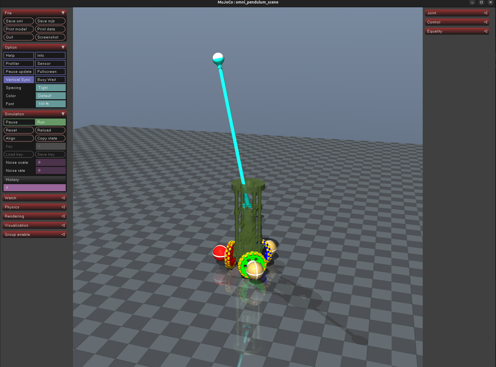

# omniwheel_mujoco

Docker-based MuJoCo simulator for the omniwheel robot. The container uses ROS 2 Humble and CycloneDDS.

## Clone

```
git clone --recursive https://github.com/Abanesjo/omniwheel_mujoco
```

## Run

```bash
./build_and_run.sh
```



The script builds the image and starts the MuJoCo viewer with ROS 2 publishers/subscribers active.
It uses host networking and CycloneDDS on multicast-enabled loopback, matching the
`omniwheel_ros` Docker setup.

The sensors publish at 100 Hz and the physics step runs at 500 Hz.


## Control Input

The simulator matches the real robot's public velocity-command interface. Publish a
base-frame twist on `/nav_vel`; the controller uses `linear.x`, `linear.y`, and
`angular.z`:

```bash
ros2 topic pub -r 50 /nav_vel geometry_msgs/msg/Twist \
  "{linear: {x: 0.2, y: 0.0, z: 0.0}, angular: {x: 0.0, y: 0.0, z: 0.0}}"
```

The host is not required to have ROS 2. To publish a test command, open a second terminal,
enter the running container, and source its workspace before running the command above:

```bash
docker exec -it omniwheel_mujoco bash
source /opt/ros/humble/setup.bash
source /workspace/ros2_ws/install/setup.bash
```

The simulator converts the base twist to individual wheel angular velocities with the
same geometry and Jacobian convention as the real velocity controller. Base commands
are slew-limited to `2.0 m/s^2` independently on x and y and to `2.2 rad/s^2` in yaw,
then converted to wheel targets and clamped to `7.194247 rad/s`. Commands older than
`0.5 s` ramp back to zero rather than leaving the last velocity active. These values can
be changed in `simulate/config.yaml`; the higher fallback values are `8.0 m/s^2` and
`20.0 rad/s^2` if the exported policy needs its training-time acceleration envelope.

## Run the exported RL policy

```bash
./build_and_run_rl.sh
```

This variant uses the distinct `omniwheel_mujoco_rl` container name and launches both
the simulator and `omniwheel_policy_node`. The policy runs from the installed
`models/policy.onnx` export, consumes `/joint_states` and `/odometry/filtered` at 50 Hz
using simulation time, and publishes commands on `/nav_vel`. The accompanying
`policy.pt` export is packaged with the ROS package for reference, but runtime inference
uses ONNX Runtime.

The normal `build_and_run.sh` path leaves policy execution disabled. It can also be
enabled manually inside the image with:

```bash
ros2 launch omniwheel_mujoco_sim sim.launch.py run_policy:=true
```

An alternate ONNX file can be selected with
`policy_model_path:=/absolute/path/to/policy.onnx`.

## Published Interfaces

- `/odometry/filtered` (`nav_msgs/msg/Odometry`), localization-equivalent MuJoCo truth in `odom -> base_footprint`
- `/tf`, including dynamic `odom -> base_footprint`
- `/omni/wheel_odometry` (`geometry_msgs/msg/TwistWithCovarianceStamped`)
- `/joint_states` (`sensor_msgs/msg/JointState`)
- `/omni/encoder_angles` (`std_msgs/msg/Float32MultiArray`)
- `/clock` (`rosgraph_msgs/msg/Clock`)

The sim does not publish camera or LiDAR topics and does not run `robot_localization`.

## DDS

The project assumes CycloneDDS. Edit `cyclonedds.xml` before running either launch
script to change its configuration.
